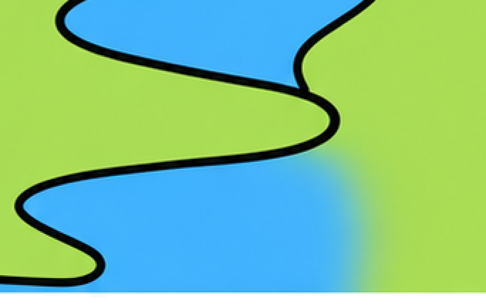
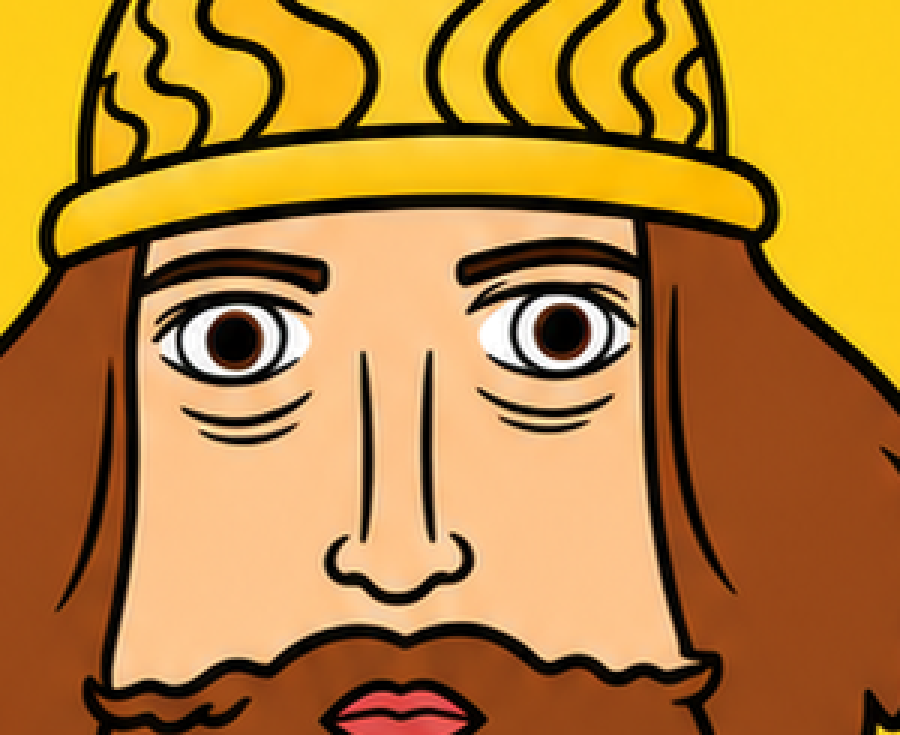

# Pregled obiju knjiga — 16. studenoga 2026.

Pregledane su sve 23 stranice bojanke **Boje iz davnina** i sve 23 stranice slikovnice **Kad priroda priča**, u verziji iz objave `cd4fddfa6410eb85f66bedc8d59369f6cd4075c9`. Pregled obuhvaća stvarne PDF-ove i ZIP dostupne na GitHubu, tekst, prikaz svake stranice te detalje ilustracija. Pregled je napravljen bez podagenata.

**Ocjena:** sadržaj i traženi redoslijed su uređeni. Preostaju konkretne dorade ilustracija i prijeloma; knjige još nisu završno pripremljene za profesionalni tisak.

## Provjereno i ispravno

- [x] Obje knjige imaju 23 stranice u formatu A4.
- [x] Nakon naslovnice i stranice za ime slijedi **slika pa tekst o istom bogu**, svih deset puta.
- [x] Redoslijed bogova: Stribog, Svarog, Vesna, Jarilo, Lada, Perun, Mokoš, Dažbog, Morana, Veles.
- [x] U bojanci su kratki opisi toga tko je bog i što radi; nema malih priča ni dodatnih zadataka na stranicama bogova.
- [x] U slikovnici su potpune priče. Nisu zamijenjene kratkim opisima iz bojanke.
- [x] Nigdje nisu ostali „Biraj boje”, palete kružića, „Za bojanje”, „Mala igra”, stari „hop hop” citati ni „Odaberi svoju boju”.
- [x] Uklonjena je dodatna stranica „Čitajmo zajedno”. Završna stranica 23 namjenski je prostor za dječji crtež.
- [x] Svih deset unutarnjih ilustracija u bojanci je crno-bijelo; svih deset u slikovnici je obojeno.
- [x] Posljednje spremljene ilustracije Svaroga, Peruna i Mokoši stvarno su ugrađene u oba PDF-a.
- [x] Mokoš na stranici 15 slikovnice ima smeđe šarenice. U bojanci oči ostaju linijski crtež za bojanje.
- [x] Simbol Svaroga na stranici 6 ima prepoznatljivu poprečnu glavu čekića i drvenu dršku.
- [x] Svih deset glavnih simbola je prisutno, a njihov slikovni okvir ne prekriva tekst.
- [x] Tekstualne stranice imaju različite rasporede simbola, naslova i teksta, uz zajedničku obitelj fontova i ukrasa.
- [x] Svi naslovi bogova vidljivi su u zasebno renderiranim PDF-ovima. Hrvatski znakovi prikazuju se ispravno.
- [x] Tekst je cjelovit, nije izvan stranice i ostaje označiv. Fontovi kojima je ispisan tekst ugrađeni su u PDF.
- [x] Najmanji razmak teksta od ruba na stranicama bogova iznosi oko 23 mm. Glavni tekst ima 24 pt u bojanci i 21,5 pt u slikovnici.
- [x] Postavljen je prikaz jedne stranice; ilustrirani slikovni okvir zauzima cijeli A4.
- [x] PDF oznake za navigaciju vode na odgovarajuće ilustracije.
- [x] Sva tri GitHub preuzimanja vraćaju potpune datoteke i odgovaraju pregledanim kontrolnim zbrojevima.
- [x] ZIP se otvara bez greške i sadrži upravo oba pregledana PDF-a.

## Ostalo za doradu

| Prioritet | Mjesto | Nalaz i potrebna dorada |
|---|---|---|
| Važno | Ilustracije u obje knjige | U izvorne slike ugrađeni su neujednačeni bijeli rubovi. Svarog na str. 5 ima oko **30 mm bijelog prostora iznad crteža**; Dažbog na str. 17 oko **13 mm desno**, a Veles na str. 21 oko **4 mm desno**. Na više obojenih ilustracija postoji i tanak bijeli pojas pri dnu. Treba urediti kadar i rubove uz očuvanje glava, ruku i rekvizita. |
| Važno | Slikovnica, Vesna, str. 7 | Pri dnu potoka plava boja prelazi izvan crne konture i raspršuje se u zelenu površinu. Treba zatvoriti konturu i urediti ispunu. |
| Važno | Slikovnica, Dažbog, str. 17 | Oko zjenica postoji tanak smeđi rub, ali velik dio omeđene šarenice ostaje bijel. Treba dovršiti boju šarenica i smiriti dojam pogleda, u postojećem stilu. |
| Manja dorada | Slikovnica, Morana, str. 20 | Pahuljica je preblizu točki na kraju prvog retka i može izgledati kao znak uz tekst. Treba je odmaknuti. |
| Manja dorada | Slikovnica, Vesna, str. 8 | Završna riječ „cvijet.” ostaje sama u retku. Treba malo prilagoditi prijelom odlomka. |
| Završno stilsko usklađivanje | Naslovnice, uvod i unutarnje stranice | Crne konture i boje povezuju knjige, ali naslovnice imaju mekša, karikaturalnija lica od dijela unutarnjih crteža. Uvodna i završna stranica imaju pravilnije ukrasne okvire od novih otvorenih tekstualnih stranica. Potpuno isti autorski potez još nije postignut; ovo je vizualna ocjena, a ne tehnička greška. |

Promjena prikaza na jednu stranicu nije uklonila bijele površine koje su već dio slike. Raniji zaključak da je problem samo u dvostraničnom prikazu bio je nepotpun.

### Detalji iz stvarno poslanih ilustracija

Vesnin potok na stranici 7:

Dažbogove djelomično obojene šarenice na stranici 17:

## Priprema za profesionalni tisak

- [ ] **Rezolucija ilustracija.** Svaka glavna ilustracija ima 1022 × 1445 piksela, što je približno **124 dpi na A4**. To je ispod uobičajenog cilja od 300 dpi za kvalitetan tisak ilustracija. Tekst ostaje vektorski i nema taj problem. Samo promjena zapisa na „300 dpi” ne vraća detalje u slike.
- [ ] **Napust za rezanje.** Stranice završavaju na granici A4; nije pripremljeno dodatno područje slike izvan konačnog reza. Veličinu napusta treba uskladiti s tiskarom i stvarnim konačnim formatom.
- [ ] **Priprema boja.** Ilustracije su RGB, bez izlaznog ICC profila. Završni profil boja i eventualnu PDF/X inačicu treba pripremiti prema zahtjevu tiskare.
- [ ] **Uvez i raspored listova.** Svaka knjiga sada ima 23 stranice prema traženom sadržaju. Za klamani uvez broj stranica treba uskladiti s višekratnikom četiri. Rješenje ovisi i o tome pripremaju li se korice odvojeno; dodatne stranice ne treba proizvoljno vraćati u čitateljski PDF.
- [ ] **Probni otisak.** Nakon dorada provjeriti stvarnu veličinu teksta, rubove, tanke linije, nijanse kože i tamne površine na probnom primjerku.

## Pregled svih stranica

Brojevi su brojevi stranica u PDF-u. Slika i tekst o istom bogu imaju isti raspored u obje knjige.

| Stranica | Sadržaj | Bojanka | Slikovnica |
|---|---|---|---|
| 1 | Naslovnica | Naslov ispravan; pojednostavljena kompozicija | Naslov ispravan; zadržana kompozicija prirode |
| 2 | Ova knjiga pripada | Tekst odgovara kratkim opisima na poleđini | Upute za zajedničko čitanje čitljive |
| 3 | Stribog — ilustracija | Crno-bijela, prisutna | Obojena, prisutna; tanki bijeli rubovi |
| 4 | Stribog — tekst | Kratak opis i simbol vjetra | Potpuna priča i simbol vjetra |
| 5 | Svarog — ilustracija | Posljednja izmjena; velik bijeli prostor gore | Posljednja izmjena; velik bijeli prostor gore |
| 6 | Svarog — tekst | Kratak opis; ispravljen simbol čekića | Potpuna priča; ispravljen simbol čekića |
| 7 | Vesna — ilustracija | Crno-bijela, prisutna | Doraditi prelazak plave boje izvan potoka |
| 8 | Vesna — tekst | Kratak opis i cvjetni simbol | Doraditi usamljenu završnu riječ „cvijet.” |
| 9 | Jarilo — ilustracija | Crno-bijela, prisutna | Obojena, prisutna; provjeriti bijele rubove |
| 10 | Jarilo — tekst | Kratak opis; raspored livade | Potpuna priča; cvijeće i motiv livade |
| 11 | Lada — ilustracija | Crno-bijela, prisutna | Obojena, prisutna |
| 12 | Lada — tekst | Kratak opis i srce | Potpuna priča i srce |
| 13 | Perun — ilustracija | Posljednja čista linijska verzija | Posljednja obojena verzija |
| 14 | Perun — tekst | Kratak opis i munje | Potpuna priča i munje |
| 15 | Mokoš — ilustracija | Linijska verzija za bojanje | Smeđe šarenice potvrđene |
| 16 | Mokoš — tekst | Kratak opis i stablo | Potpuna priča i stablo |
| 17 | Dažbog — ilustracija | Provjeriti bijeli prostor desno | Doraditi šarenice i bijeli prostor desno |
| 18 | Dažbog — tekst | Kratak opis i sunce | Potpuna priča i sunce |
| 19 | Morana — ilustracija | Crno-bijela, prisutna | Obojena, prisutna |
| 20 | Morana — tekst | Kratak opis; ukras uz prvi redak tijesan | Odmaknuti pahuljicu od kraja prvog retka |
| 21 | Veles — ilustracija | Crno-bijela; provjeriti rub desno | Obojena; provjeriti rub desno |
| 22 | Veles — tekst | Kratak opis i sova | Potpuna priča i sova |
| 23 | Prostor za dječji crtež | Namjenski prazan prostor; upute vidljive | Namjenski prazan prostor; upute vidljive |

## Redoslijed dorade

1. Urediti Vesninu ispunu i Dažbogove šarenice uz očuvanje ostalog crteža.
2. Ujednačiti kadar i bijele rubove ilustracija, posebno Svaroga i Dažboga.
3. Odmaknuti Moraninu pahuljicu i urediti prijelom Vesnine priče.
4. Napraviti završni stilski pregled naslovnica, simbola i okvira.
5. Pripremiti rezoluciju, napust, boje i uvez prema konačno odabranom tisku, pa provjeriti probni otisak.

PDF-ovi na koje se ovaj pregled odnosi nalaze se u mapi [knjige](knjige). U ovom pregledu dokumentirane su provjere i preostale dorade.

## Identitet pregledanih datoteka

| Datoteka | Veličina u bajtovima | SHA-256 |
|---|---:|---|
| Boje-iz-davnina.pdf | 9216145 | `dfc0e640a03d7d803b959787aae85946a61f2b42ebb255e04e363e3e1fedadb7` |
| Kad-priroda-prica.pdf | 22733474 | `618222d240fbb9620bdcff8917aba41eb7162f905c42e3b782abd6c1f7554fe6` |
| Obje-knjige.zip | 27720930 | `9393bf5d34154dcd1e92c24909b0cbdbe62b40592b4879ebc09e55766e4912ff` |
